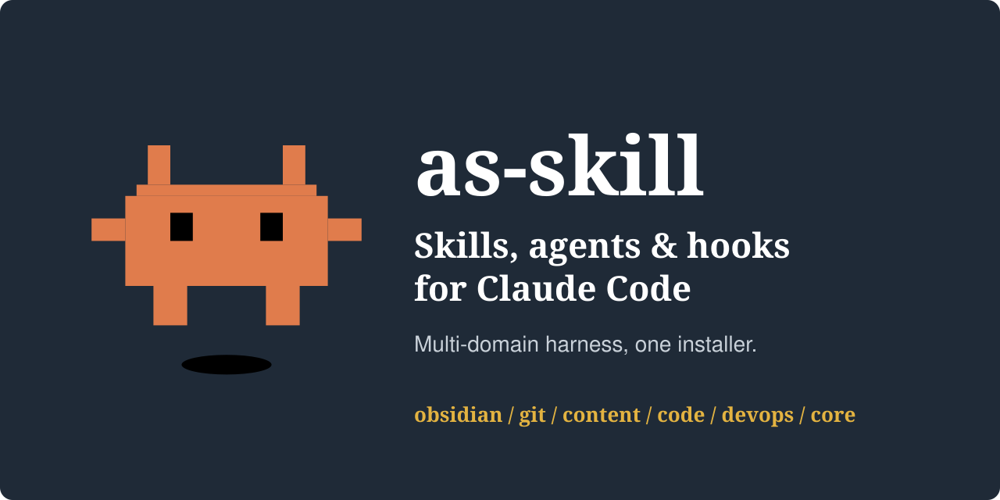

<p align="center">

  

</p>

# as-skill

🇷🇺 [Русская версия](README_RUS.md)

A repository of templates for agents, skills, rules and hooks for AI coding agents — Claude Code, Codex, Cursor, OpenCode — organized by domain. The platform is chosen with the `-a` flag (autodetected by default, otherwise `claude`), see [Platforms](#platforms).

## Table of contents

- [Domains](#domains)
- [Repository structure](#repository-structure)
- [Hooks](#hooks)
- [Installation (the `as-skill` CLI)](#installation-the-as-skill-cli)
- [Platforms](#platforms)
- [Contributing and security](#contributing-and-security)
- [License](#license)

## Domains


| Domain                              | Requirements         | Description                                                                                                                                                                                                      |
| ----------------------------------- | -------------------- | ---------------------------------------------------------------------------------------------------------------------------------------------------------------------------------------------------------------- |
| [**`obsidian`**](domains/obsidian/) | env `OBSIDIAN_VAULT` | A PKB on Obsidian following PARA — ingesting sources into the vault, inbox triage, frontmatter enrichment, note critique, splitting large notes and lectures, untangling MOC hubs.                               |
| [**`git`**](domains/git/)           | —                    | Git workflow — Conventional Commits (subject only, no AI attribution), PR descriptions, semver releases with a tag and a GitHub release.                                                                         |
| [**`content`**](domains/content/)   | —                    | Content — Telegram posts, articles, technical documentation, a content factory, humanizing Russian-language text.                                                                                                |
| [**`code`**](domains/code/)         | —                    | The development loop: plan → build → review → debug. A portable mini-harness — installs into any other project.                                                                                                  |
| [**`core`**](domains/core/)         | —                    | Skills not tied to a specific area: an ultra-compressed communication mode (`caveman`), a project memory bank, memory bank defragmentation, fact-checking web search (`advanced-search`).                        |
| [**`devops`**](domains/devops/)     | —                    | Kubernetes, Helm, GitLab CI, ArgoCD — Consilium agents (architecture, security, SRE, diagnostics; read-only, advisory) and Executing agents (CI, Helm, K8s; write pipelines, charts and manifests).              |
| [**`university`**](domains/university/) | —                    | Graduation thesis (ВКР) — a writer agent, a reviewer agent, and a skill that turns a Markdown thesis into a GOST 7.32 `.docx` (title page, TOC, page numbers, figure and table captions) and checks it. |


`obsidian` is installed only when `OBSIDIAN_VAULT` is set — the path to the vault root (`export OBSIDIAN_VAULT="$HOME/path/to/vault"`, for example in `~/.zshrc`). Without it, `install all` skips the domain with a warning, while an explicit `install domain obsidian` fails with an error. The other domains are always installed.

## Repository structure

```
as-skill/
├── domains/                 # Single Source of Truth
│   ├── obsidian/
│   │   ├── manifest.yaml    # targets, requires_env
│   │   ├── rules/
│   │   ├── skills/<name>/{SKILL.md, README.md}
│   │   └── agents/
│   ├── git/     {manifest, rules, skills, agents}
│   ├── content/ {manifest, rules, skills, agents}
│   ├── code/    {manifest, skills, agents, hooks}
│   ├── core/    {manifest, skills, hooks}
│   ├── devops/  {manifest, agents}
│   └── university/ {manifest, rules, skills, agents}
│
├── tools/
│   ├── main.go             # as-skill CLI entry point, see tools/README.md
│   ├── internal/           # Command dispatcher and installer logic
│   └── README.md
│
├── install.sh              # Builds as-skill and puts it on the PATH of the current shell (source install.sh)
├── CLAUDE.md               # Entry point for AI agents
├── CONTRIBUTING.md         # How to edit the repository: adding domains/skills
├── SECURITY.md             # Threat model, what the installer does with data
├── LICENSE
└── README.md
```

## Hooks

Hooks live in `domains/<domain>/hooks/` and are copied by the installer into the project's `.claude/hooks/` (for `-a codex|cursor` — into `.codex/hooks/` and `.cursor/hooks/`, registered via `as-skill hooks enable`; opencode has no hooks). They are registered in `.claude/settings.json` by the `/code-init` skill or by the `hooks` step of the `as-skill add` dialog (opt-in: you select them explicitly, none by default, `-y` registers no hooks; each hook declares its own event and matcher in the `# register:` header). `as-skill remove` removes the registrations automatically.


| Hook                 | Domain | Event        | What it does                                                                                                                                  |
| -------------------- | ------ | ------------ | --------------------------------------------------------------------------------------------------------------------------------------------- |
| `test-gate`          | `code` | Stop         | Blocks finishing the task if code files were edited but no tests were run during the session (fail-open, at most 2 blocks per commit).        |
| `prettier-format`    | `code` | PostToolUse  | Runs prettier once the test-gate condition is met; a no-op without a prettier config.                                                         |
| `memory-bank-load`   | `core` | SessionStart | Loads `.memory-bank/index.md` (up to 16 KB) and the list of the other Memory Bank files into the context.                                     |
| `memory-bank-logger` | `core` | SessionEnd   | A background `claude -p` reads the session transcript and updates `.memory-bank/` through the `memory-bank` skill (skips short sessions).     |


For more details see `domains/code/hooks/README.md` and `domains/core/hooks/README.md`.

## Installation (the `as-skill` CLI)

From the repository root (needs Go ≥ 1.25, on macOS `brew install go`; the first build downloads dependencies from the Go module proxy once, so a network connection is required):

```bash
source install.sh   # builds as-skill and adds it to PATH (current and new terminals)
```

Without the script: `go build -o as-skill ./tools`.

Quick start — in the project you are equipping:

```bash
as-skill add
```

A dialog opens: project → domains → platforms → mode → confirmation. All commands, flags and modes (`symlink` / `--copy`) are described in [`tools/README.md`](tools/README.md).

## Platforms

`-a claude|codex|cursor|opencode[,…]|all` (by default autodetected from existing platform directories, otherwise `claude`). The matrix is the output of `as-skill list platforms`:


| Platform | skills                  | agents                      | rules                                | hooks                                         | Status                                                                                       |
| -------- | ----------------------- | --------------------------- | ------------------------------------ | --------------------------------------------- | -------------------------------------------------------------------------------------------- |
| claude   | `.claude/skills` (link) | `.claude/agents` (link)     | `.claude/rules` (link)               | `.claude/hooks` -> `.claude/settings.json`    | verified 2026-10-27                                                                          |
| codex    | `.agents/skills` (link) | `.codex/agents` (render)    | `.agents/rules` + a block in `AGENTS.md` | `.codex/hooks` -> `.codex/hooks.json`     | not verified — based on vendor documentation as of 2026-10-27, the real CLI was not run      |
| cursor   | `.agents/skills` (link) | `.cursor/agents` (render)   | `.cursor/rules` (render, `.mdc`)     | `.cursor/hooks` -> `.cursor/hooks.json`       | not verified — based on vendor documentation as of 2026-10-27, the real CLI was not run      |
| opencode | `.agents/skills` (link) | `.opencode/agents` (render) | `.agents/rules` + a block in `AGENTS.md` | not supported                             | not verified — based on vendor documentation as of 2026-10-27, the real CLI was not run      |


- **link vs render.** Skills and rules for claude are symlinks (or copies with `--copy`). Agents on non-claude platforms are generated in the native format: edits to the body are picked up immediately, edits to the frontmatter require a reinstall (`as-skill doctor` will show STALE).
- **Duplicate skills.** claude+codex together: skills are visible from two directories. Cursor and opencode read both `.claude/skills` and `.agents/skills`, so they see skills twice; `doctor` warns with DUPLICATE-SKILL.
- **Invocation:** `/code-plan` — Claude and Cursor, `$code-plan` — Codex. In OpenCode the agent picks up a skill by its description; `/` invocation is not described in its documentation.
- **Hooks.** Codex: after `hooks enable`, confirm the hooks via `/hooks` (trust). Cursor: `stop` cannot block, so `followup_message` is used, at most 2 times. opencode: hooks are not supported. It is worth adding session directories (`.claude/sessions` and the like) to `.gitignore`.
- **Guard for link installs.** Symlink entries point to this copy of the repository: add `/.agents /.codex /.cursor /.opencode` (one per line) to the target project's `.gitignore`, or install with `--copy`.
- **Known issue:** `doctor` shows DRIFTED after a `--copy` install of two or more domains.

## Contributing and security

- How to edit the repository and add domains and skills — [`CONTRIBUTING.md`](CONTRIBUTING.md).
- The threat model, what the installer does with data, and how to report a vulnerability — [`SECURITY.md`](SECURITY.md).

## License

MIT — see [`LICENSE`](LICENSE).
