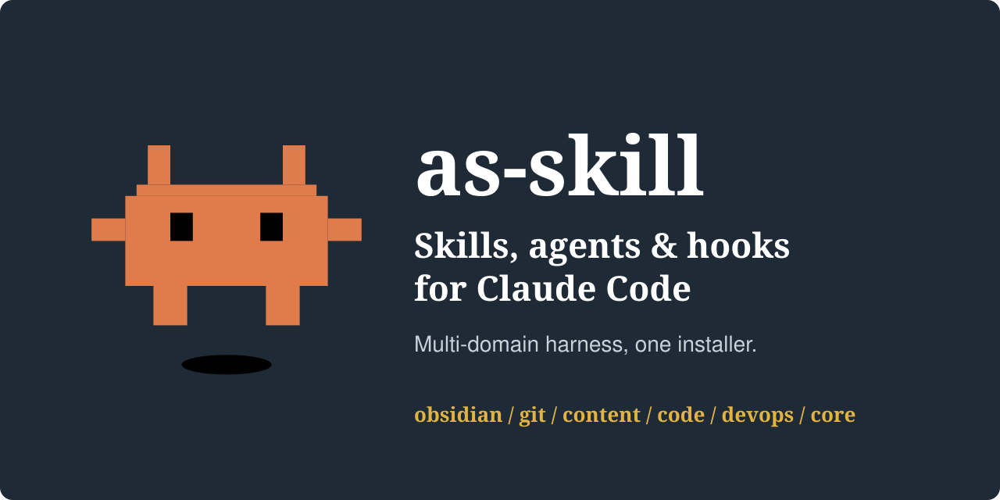

<p align="center">
  
</p>

# as-skill

Репозиторий шаблонов агентов, скиллов, правил и хуков для Claude Code, разложенных по доменам.

## Оглавление

- [Домены](#домены)
- [Структура репозитория](#структура-репозитория)
- [Хуки](#хуки)
- [Установка (CLI `as-skill`)](#установка-cli-as-skill)
- [Контрибьютинг и безопасность](#контрибьютинг-и-безопасность)
- [Лицензия](#лицензия)

## Домены

| Домен | Требования | Описание |
|-------|---------|-----------|
| **[`obsidian`](domains/obsidian/)** | env `OBSIDIAN_VAULT` | PKB на Obsidian по PARA — приём источников в базу, разбор inbox, обогащение фронтматтера, критика заметок, разбиение больших заметок и лекций, распутывание хабов-MOC. |
| **[`git`](domains/git/)** | — | Git workflow — Conventional Commits (только subject, без AI-атрибуции), описания PR, semver-релизы с тегом и GitHub release. |
| **[`content`](domains/content/)** | — | Контент — Telegram-посты, статьи, техническая документация, контент-завод, очеловечивание русскоязычного текста. |
| **[`code`](domains/code/)** | — | Цикл разработки: план → билд → ревью → дебаг. Портативный мини-харнесс — ставится в любой другой проект. |
| **[`core`](domains/core/)** | — | Скиллы, не завязанные на конкретную область: ультра-сжатый режим общения (`caveman`), project memory bank, дефрагментация memory bank, фактчекинг-поиск в вебе (`advanced-search`). |
| **[`devops`](domains/devops/)** | — | Kubernetes, Helm, GitLab CI, ArgoCD — Consilium-агенты (архитектура, security, SRE, диагностика; read-only, советуют) и Executing-агенты (CI, Helm, K8s; пишут пайплайны, чарты, манифесты). |

`obsidian` ставится только при заданном `OBSIDIAN_VAULT` — путь до корня хранилища (`export OBSIDIAN_VAULT="$HOME/path/to/vault"`, например в `~/.zshrc`). Без неё `install all` пропускает домен с предупреждением, явный `install domain obsidian` падает с ошибкой. Остальные домены ставятся всегда.

## Структура репозитория

```
as-skill/
├── domains/                 # Single Source of Truth
│   ├── obsidian/
│   │   ├── manifest.yaml    # targets, requires_env
│   │   ├── rules/
│   │   ├── skills/<имя>/{SKILL.md, README.md}
│   │   └── agents/
│   ├── git/     {manifest, rules, skills, agents}
│   ├── content/ {manifest, rules, skills, agents}
│   ├── code/    {manifest, skills, agents, hooks}
│   ├── core/    {manifest, skills, hooks}
│   └── devops/  {manifest, agents}
│
├── tools/
│   ├── main.go             # Точка входа CLI as-skill, см. tools/README.md
│   ├── internal/           # Диспетчер команд и логика инсталлятора
│   └── README.md
│
├── install.sh              # Собирает as-skill и кладёт в PATH текущей оболочки (source install.sh)
├── CLAUDE.md               # Точка входа для AI-агента
├── CONTRIBUTING.md         # Как править репозиторий: добавление доменов/скиллов
├── SECURITY.md             # Модель угроз, что делает инсталлятор с данными
├── LICENSE
└── README.md
```

## Хуки

Хуки лежат в `domains/<домен>/hooks/` и копируются инсталлятором в `.claude/hooks/` проекта; регистрирует их в `.claude/settings.json` скилл `/code-init` (каждый хук сам объявляет событие и matcher в заголовке `# register:`). При `uninstall` регистрации снимаются автоматически.

| Хук | Домен | Событие | Что делает |
|-----|-------|---------|-----------|
| `test-gate` | `code` | Stop | Не даёт завершить задачу, если правились файлы кода, а тесты за сессию не запускались (fail-open, максимум 2 блокировки на коммит). |
| `prettier-format` | `code` | PostToolUse | Запускает prettier, когда условие test-gate выполнено; без конфига prettier — no-op. |
| `memory-bank-load` | `core` | SessionStart | Подгружает `.memory-bank/index.md` (до 16 КБ) и список остальных файлов Memory Bank в контекст. |
| `memory-bank-logger` | `core` | SessionEnd | Фоновый `claude -p` читает транскрипт сессии и обновляет `.memory-bank/` через скилл `memory-bank` (короткие сессии пропускает). |

Подробнее — `domains/code/hooks/README.md` и `domains/core/hooks/README.md`.

## Установка (CLI `as-skill`)

Из корня репозитория (нужен `go`, на macOS — `brew install go`):

```bash
source install.sh   # соберёт as-skill и добавит в PATH (текущий и новые терминалы)
```

Без скрипта: `go build -o as-skill ./tools`.

Два режима установки в `.claude/` целевого проекта:

- **symlink** (по умолчанию) — правки в `domains/` видны в проекте сразу, без переустановки. Так живёт корневой `.claude/` этого репозитория — см. [`CONTRIBUTING.md`](CONTRIBUTING.md).
- **`--copy`** — статический снэпшот, не зависит от этой копии репозитория. Так ставится `code` в чужой проект.

```bash
as-skill install all                                          # все домены, symlink
as-skill install domains code core --project <path> --copy   # code в чужой проект
as-skill status                                               # что стоит и в каком состоянии (OK/MISSING/BROKEN)
```

Все команды и флаги, детали `install.sh` и ограничения Windows/fish (symlink требует Developer Mode или админа, иначе `--copy`) — в [`tools/README.md`](tools/README.md).

## Контрибьютинг и безопасность

- Как править репозиторий, добавлять домены и скиллы — [`CONTRIBUTING.md`](CONTRIBUTING.md).
- Модель угроз, что делает инсталлятор с данными, как сообщить об уязвимости — [`SECURITY.md`](SECURITY.md).

## Лицензия

MIT — см. [`LICENSE`](LICENSE).
